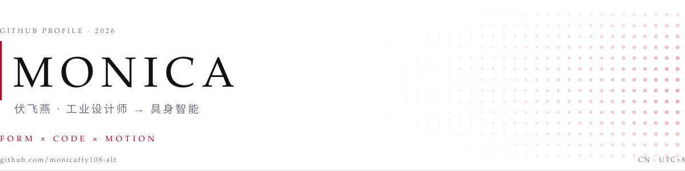
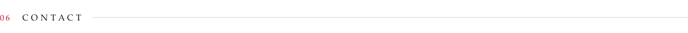

<!-- =================================================================== -->
<!--  Monica · 伏飞燕 — profile README                                     -->
<!--  Typography assets live in assets/profile/*.svg (light + dark)        -->
<!-- =================================================================== -->

<picture>
  <source media="(prefers-color-scheme: dark)" srcset="assets/profile/header-dark.svg">
  
</picture>

<a href="#"><picture><source media="(prefers-color-scheme: dark)" srcset="assets/profile/link-website-dark.svg"></picture></a> <a href="https://github.com/monicaffy108-alt"><picture><source media="(prefers-color-scheme: dark)" srcset="assets/profile/link-github-dark.svg"></picture></a> <a href="mailto:monicaffy108@gmail.com"><picture><source media="(prefers-color-scheme: dark)" srcset="assets/profile/link-email-dark.svg"></picture></a> <a href="https://xhslink.cn/m/7UPHF0BFY0z"><picture><source media="(prefers-color-scheme: dark)" srcset="assets/profile/link-red-dark.svg"></picture></a>

 

<picture>
  <source media="(prefers-color-scheme: dark)" srcset="assets/profile/sec-01-about-dark.svg">
  
</picture>

I am an industrial designer learning to write the software that makes designed objects move. My work sits between **form** and **behavior**: dexterous-hand tooling for the LinkerHand L20, URDF mass and inertia calibration against bench measurements, MuJoCo and ROS 2 simulation, and Vue interfaces that make robot data readable to designers rather than only to engineers.

I care about small tools that actually finish — every repository below runs end to end, and carries a README someone else can follow without asking me a question.

> 造型给物体意义，代码给它行为 —— 我在学着把这两种语言都讲清楚。

<picture>
  <source media="(prefers-color-scheme: dark)" srcset="assets/profile/sec-02-focus-dark.svg">
  
</picture>

**Dexterous manipulation** — gesture sequencing, vision-conditioned grasping and calibration for a 16-DoF hand, from joint presets to policies trained with LeRobot.

**Robot description & simulation** — URDF mass/inertia tooling, browser-based validators, and a Unitree G1 that walks inside MuJoCo.

**Interfaces for hardware** — Vue 3 front-ends, Blender add-ons and agent tooling that keep a human in the loop.

<picture>
  <source media="(prefers-color-scheme: dark)" srcset="assets/profile/sec-03-work-dark.svg">
  
</picture>

- **[Urdf-checker-Webber](https://github.com/monicaffy108-alt/Urdf-checker-Webber)** — browser-only URDF checker for LinkerBot dexterous hands: six automated checks, no backend, no database. `TypeScript`
- **[dexhand-inertia-toolkit](https://github.com/monicaffy108-alt/dexhand-inertia-toolkit)** — writes measured masses back into a URDF and proportionally scales all six inertia terms; batch left/right hands, then verify automatically. `Python`
- **[L20-LeRobot-ACT-Grasp](https://github.com/monicaffy108-alt/L20-LeRobot-ACT-Grasp)** — vision-conditioned grasping on the L20 hand, trained with ACT through LeRobot. `Python`
- **[l20-gesture-sequencer](https://github.com/monicaffy108-alt/l20-gesture-sequencer)** — programmable gesture layer: YAML presets, smooth joint interpolation, on-hardware calibration. `Python`
- **[Realsense-mediapipe-3d-detection](https://github.com/monicaffy108-alt/Realsense-mediapipe-3d-detection)** — real-time pose, hand, face and 80-class object detection in 3D, with XYZ readout from a depth camera. `Python`
- **[STL_Transformer](https://github.com/monicaffy108-alt/STL_Transformer)** — Blender add-on that batch-converts STL into GLB/OBJ with automatic PBR materials. `Python`

[All repositories →](https://github.com/monicaffy108-alt?tab=repositories)

<picture>
  <source media="(prefers-color-scheme: dark)" srcset="assets/profile/sec-04-toolbox-dark.svg">
  
</picture>

**Robotics** &nbsp;·&nbsp; Python · MuJoCo · ROS 2 · URDF · LeRobot
**Hardware** &nbsp;·&nbsp; LinkerHand L20 · Intel RealSense · Unitree G1
**Front-end** &nbsp;·&nbsp; Vue 3 · Vite · TypeScript · HTML / CSS
**Design** &nbsp;·&nbsp; Rhino · KeyShot · Figma · Photoshop · Illustrator
**Workflow** &nbsp;·&nbsp; Git · VS Code · WSL · Blender

<picture>
  <source media="(prefers-color-scheme: dark)" srcset="assets/profile/sec-05-github-dark.svg">
  
</picture>

<picture>
  <source media="(prefers-color-scheme: dark)" srcset="https://github-profile-summary-cards.vercel.app/api/cards/profile-details?username=monicaffy108-alt&theme=github_dark">
  
</picture>

<picture>
  <source media="(prefers-color-scheme: dark)" srcset="assets/profile/sec-06-contact-dark.svg">
  
</picture>

Design, robots, front-end, or anything in between. The fastest way to reach me is email — I answer everything.

<a href="mailto:monicaffy108@gmail.com"><picture><source media="(prefers-color-scheme: dark)" srcset="assets/profile/link-email-dark.svg"></picture></a> <a href="https://github.com/monicaffy108-alt"><picture><source media="(prefers-color-scheme: dark)" srcset="assets/profile/link-github-dark.svg"></picture></a> <a href="https://xhslink.cn/m/7UPHF0BFY0z"><picture><source media="(prefers-color-scheme: dark)" srcset="assets/profile/link-red-dark.svg"></picture></a>

 

© 2026 Monica · 伏飞燕 · form × code × motion
