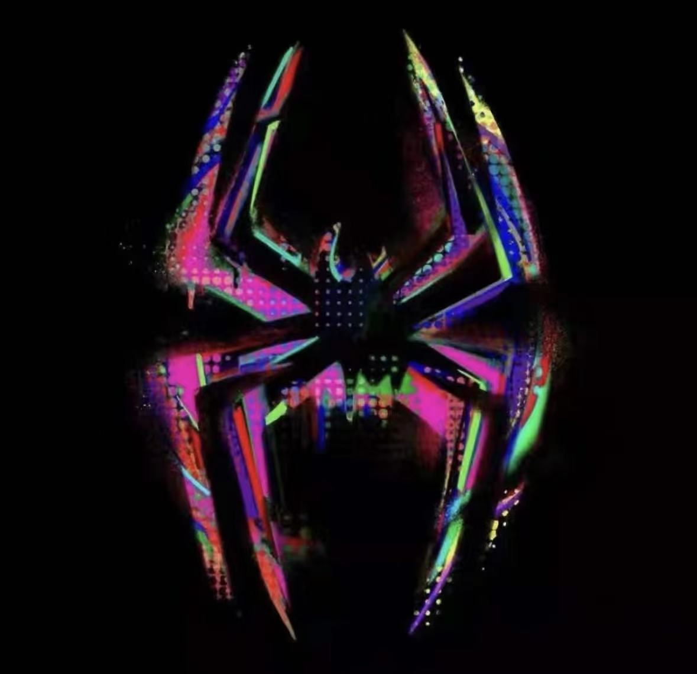
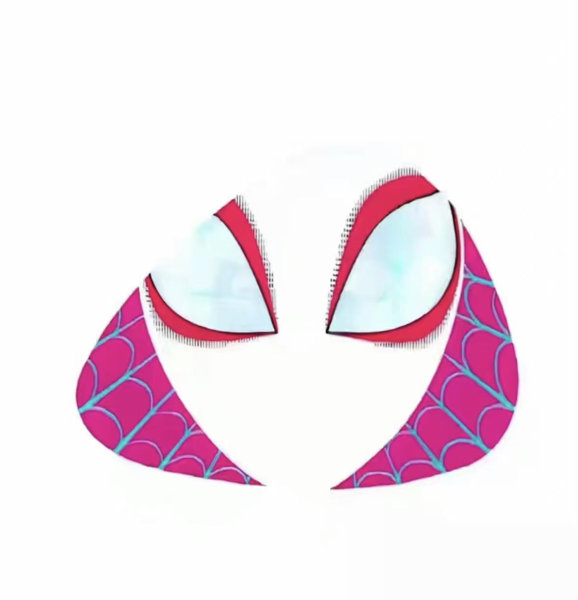
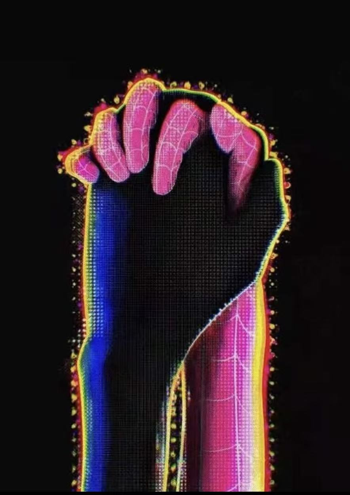
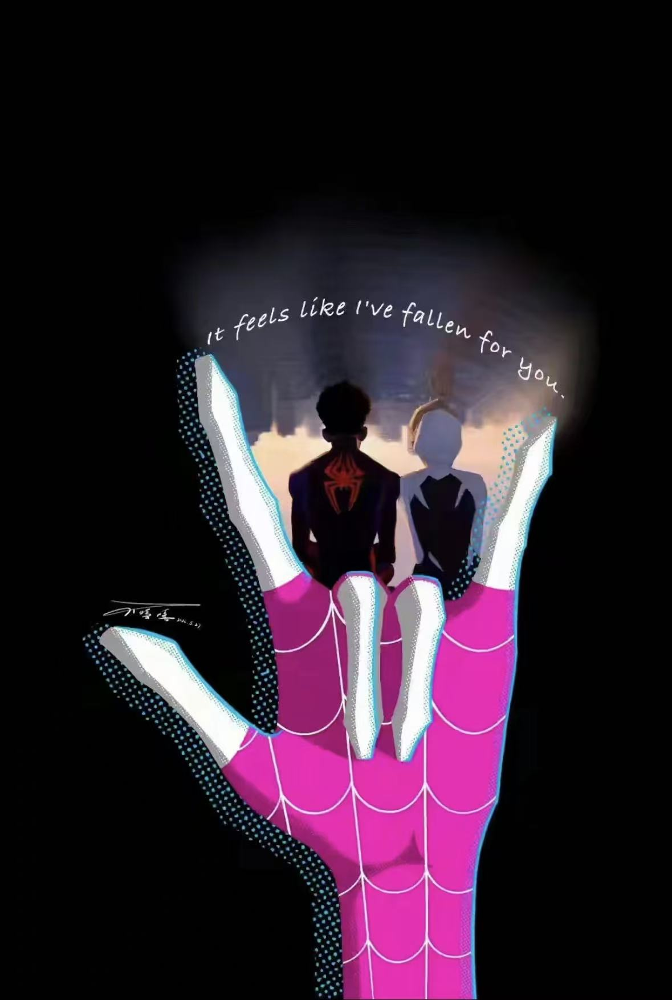
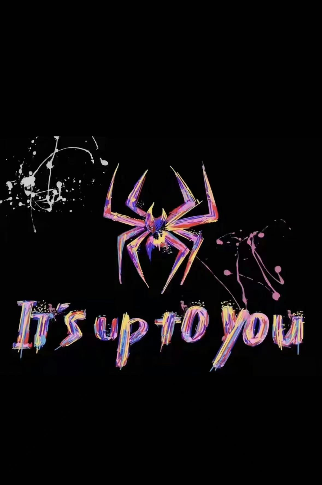

<!-- =============================================================== -->
<!--   Monica · SPIDER-VERSE × BLACKPINK · 粉黑高饱和涂鸦风          -->
<!-- =============================================================== -->

<div align="center">

<!-- ─── HERO BANNER · 彩虹蜘蛛 logo ──────────────────────────── -->


<!-- ─── 主标题 · 漫画粗体 ──────────────────────────────────── -->

<h1>
  
</h1>

<!-- ─── 副标题 · 电影感副标 ──────────────────────────────── -->


<br/><br/>

<!-- ─── 极简链接（粉色高饱和按钮） ─────────────────────── -->

<a href="https://github.com/monicaffy108-alt">
  
</a>
<a href="mailto:monicaffy108@gmail.com">
  
</a>
<a href="https://xhslink.cn/m/7UPHF0BFY0z">
  
</a>

</div>

<br/>

<!-- ─── 分割线 · 极客风蛛丝 ───────────────────────────── -->

```diff
- - - - - - - - - - - - - - - - - - - - - - - - - - - - - - - - - - - -
+ >>> THE  MULTIVERSE  IS  CALLING _
- - - - - - - - - - - - - - - - - - - - - - - - - - - - - - - - - - - -
```

<br/>

## `> WHOAMI`

<table>
<tr>
<td width="70%" valign="top">

```yaml
# ────────── SPIDER-DEX / profile.yaml ──────────

name        : Monica
alias       : monicaffy108-alt
role        : Industrial Designer  →  Full-Stack Learner
location    : Somewhere in the Multiverse (CN)

now_playing : MuJoCo · ROS · Vue 3
sketching   : robots that behave gracefully
building    : interfaces designers actually like

mindset     : |
    Form gives objects meaning.
    Code gives them behavior.
    I'm learning to speak both.

motto       : "form × code × motion — it's up to you."
fuel        : coffee ∞
spider_sense: tingles @ bad UX
```

</td>
<td width="30%" valign="top" align="center">

<br/>



<br/><br/>

<sub>
<b style="color:#FF0080;">STATUS</b><br/>
<code>learning · shipping</code><br/><br/>
<b style="color:#FF0080;">STACK</b><br/>
<code>Python / Vue</code><br/><br/>
<b style="color:#FF0080;">FUEL</b><br/>
<code>coffee ∞</code>
</sub>

</td>
</tr>
</table>

<br/>

## `> WHAT_I'M_BUILDING`

<table>
<tr>
<td width="33%" valign="top">

###  &nbsp; ROBOTICS × SIM

Embodied intelligence via **MuJoCo** & **ROS**. Making physics feel intuitive to designers.

<sub>`Python` `MuJoCo` `ROS`</sub>

</td>
<td width="33%" valign="top">

###  &nbsp; DESIGN × CODE

**Vue** interfaces built with a designer's eye — motion, hierarchy, restraint.

<sub>`Vue` `Vite` `HTML/CSS`</sub>

</td>
<td width="33%" valign="top">

###  &nbsp; LEARN IN PUBLIC

Notes, sketches & prototypes as I cross from **objects** into **software**.

<sub>`Study` `Sketch` `Ship`</sub>

</td>
</tr>
</table>

<br/>

## `> TOOLBOX`

<div align="center">



<br/>

**🤖 &nbsp; ROBOTICS &&nbsp;AI**


<br/>

**🌐 &nbsp; FRONT-END**


<br/>

**🎨 &nbsp; DESIGN**


<br/>

**🛠 &nbsp; WORKFLOW**


</div>

<br clear="right"/>

<br/>

## `> GITHUB_STATS`

<div align="center">


<br/><br/>


<br/>


</div>

<br/>

<!-- ─── QUOTE 图 ─────────────────────────────────────── -->

<div align="center">
  
</div>

<br/>

## `> GET_IN_TOUCH`

<div align="center">

<sub>Design. Robots. Front-end. Anything in between.</sub><br/>
<sub>Slide into the multiverse ↓</sub>

<br/><br/>

<a href="mailto:monicaffy108@gmail.com">
  
</a>
<a href="https://github.com/monicaffy108-alt">
  
</a>
<a href="https://xhslink.cn/m/7UPHF0BFY0z">
  
</a>

</div>

<br/><br/>

<!-- ─── 结尾 · IT'S UP TO YOU 大图 ─────────────────── -->

<div align="center">
  
</div>

<br/>

<div align="center">
  <sub>
    <code>©  MONICA  ·  ANOTHER  UNIVERSE  ·  KEEP  SWINGING  🕷️</code>
  </sub>
</div>
